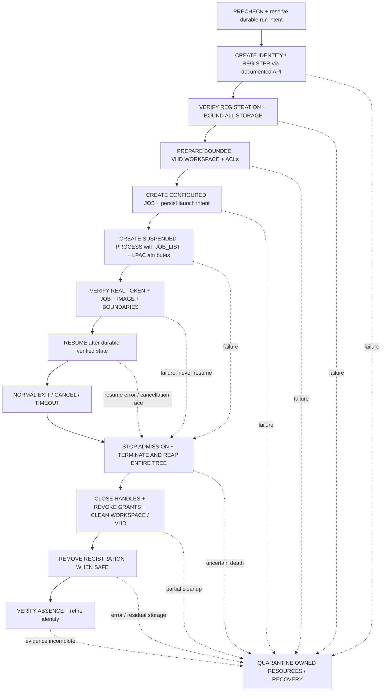

# D2: تسجيل هوية LPAC مستقلة لكل تشغيل — مراجعة تصميم

**القرار: BLOCKED للإنتاج.** الاتجاه الموصى بدراسته هو **A: profile مسجل، فريد ومملوك لكل تشغيل**، وليس تطبيقه الآن. دليل D2-C يفسر فشل الإطلاق على Windows الملتقط، لكنه لا يثبت سلامة الإطلاق بعد التسجيل ولا حصر التخزين أو الشبكة. إنشاء profile قد يضيف مخزن ملفات وسجل دائمًا خارج VHD؛ وهذه بوابة أمنية يجب إثباتها، لا تفصيل تنظيف مؤجل.

هذه وثيقة للمراجعة فقط. **لم يُفعّل التصميم أو backend، ولم يُغلق D2 أو Blocker D.** لا تفوض الوثيقة تعديل MissionRuntime أو ToolRegistry أو D4 أو تخفيف أي اختبار أو صلاحية. تنفيذ تجربة معزولة لاحقًا، ثم أي تغيير إنتاجي، يتطلبان مراجعة وموافقة منفصلتين.

## ما الذي راجعناه؟

نقطة الأساس هي `7fd3e62d0fcc65660861c8afa1e95cb059ede9ce` على `fix/blocker-d2-lpac-20261021`. هذا commit يضيف ستة ضوابط إطلاق معلقة فقط وتتبّعها، وليس تسجيل profile. الأثر الحاسم أقدم، عند `2520f02f3e147bc50eb3175491c7b1226fc2738d`؛ لا يجوز نسب التقاطه إلى commit التصميم. تقرير D2-C محفوظ منفصلًا باسم `D2_LPAC_FORENSIC_C_REPORT.md` في مخزن الأدلة الخاص.

المراجع التي يجب أن تبقى ثابتة:

- `main`: `8a3fd109c0e586db13ed48a7371ac9ad06465b74`.
- D4، الفرع `fix/blocker-d-review-20261010`: `77515ed87435b051faf0d16a04ee89246eeff1aa`.
- `v5.1.0`: كائن tag هو `684b344c183da1dee8dfd229c93cef0fd29396a5`، والـcommit المشار إليه `26739d9b01b3b1ff492854e7e21789be20b1be0e`.

خطة هذه المراجعة: تدقيق الاسترجاع والأصل، مقارنة عقود Windows بالبدائل، تحديد حالات دورة الحياة والتهديدات، ثم صياغة بوابات إثبات أصلية ومراجعة مستقلة. ملفات الخطط القديمة لم تُستبدل؛ هذه ليست خطة تنفيذ إنتاجي.

## الدليل: ما يراه الأثر، وما تضيفه الرموز، وما لم يثبت

ملفات ProcMon الخام حساسة، وقد تحتوي البيئة والمسارات. لا تُضاف إلى هذا المستودع العام ولا تُرفق في محادثة عامة. [ملخص تدقيق الأصلين](D2_LPAC_EVIDENCE_AUDIT_2026-10-22_AR.md) يحدد بدقة ما فُتح وطريقة فحصه؛ تطابق hash لا يساوي بمفرده تفسير محتوى PML. أُعيد حساب البصمتين من الملفين الأصليين وطابقتا القيم أدناه، وقُرئت أحداث CSV الأصلية وأُعيد تحليل الأحداث الثمانية وstacks من PML باستخدام `procmon-parser==0.4.0`، لا الاكتفاء بملخص JSON. هذا فحص فعلي محدد للأحداث المختارة، وليس مراجعة كل حدث في PML أو تشغيل ProcMon تفاعليًا.

الأصل محفوظ محليًا تحت مخزن الأدلة المعتمد `/workspace/d2-forensic-c-evidence/`، في artifact تشغيل [39846051936](https://github.com/mosfiry/cybersentinel/actions/runs/39846051936). صلاحية الاحتفاظ الأصلية في workflow هي 30 يومًا؛ توفر النسخة المحلية الآن لا يضمن بقاء التنزيل البعيد. لا نحتاج إعادة رفع الخام علنًا للتحقق من التصميم.

| الأصل | الحجم بالبايت | SHA-256 المتوقع |
|---|---:|---|
| `launch.pml` | 187716035 | `595f3ba59d5e1a843fd8a169d82f06fe031f8ea95f72c0da9a4c17e923c923da` |
| `launch.csv` | 70486722 | `ad2baf917525fe55404748184cca520ddaa1db294716cb82f26202c7ea9cae3e` |

**المشاهدة الأصلية المطلوبة:** في أربعة brokers تظهر محاولة فتح mapping خاص بـpackage SID في HKCU ثم fallback خاص بالـSID في StateRepository في HKLM؛ كلاهما `NAME NOT FOUND / 0xC0000034`. أول miss ليس وحده عطلًا نهائيًا. لا نعرض SID الفعلي هنا.

```text
HKCU\Software\Classes\Local Settings\Software\Microsoft\Windows\CurrentVersion\AppContainer\Mappings\<PACKAGE_SID>
HKLM\SOFTWARE\Microsoft\Windows\CurrentVersion\AppModel\StateRepository\Cache\PackageFamily\Index\PackageSID\<PACKAGE_SID>
```

أرقام CSV التالية **سجلات منطقية تشمل header كسجل 1، وليست أرقام أسطر نصية**:

| broker PID | نجاح namespace | غياب mapping | غياب fallback |
|---:|---:|---:|---:|
| 1296 | 370573 | 370592 | 370665 |
| 8288 | 382642 | 382665 | 382714 |
| 5724 | 385203 | 385210 | 385237 |
| 3328 | 387366 | 387378 | 387409 |

**إسناد الرموز وتفسير البرنامج:** العناوين الخام في stacks ليست أسماء دوال. مطابقة PE timestamp وSizeOfImage ثم CodeView GUID/age مع Microsoft PDB تتيح إسناد المسار إلى `CreateProcessW → CreateProcessInternalW → TokenExtCreateEnvironment → AppContainerLookupMoniker`، مع فرعي `LookupMonikerFromRegistry/OpenAppContainerKey` و`LookupMonikerFromSRCache/OpenByPackageSIDAsString`. `BasepAppContainerEnvironmentExtension` يظهر كذلك في تحليل disassembly؛ لا يلزم أن يبقى frame مستقلًا بسبب tail jump. أقرب public symbol قرينة إسناد، وليس تتبعًا حيًا لقيم المتغيرات أو سجل الإرجاع.

في الصور المطابقة، يتعامل `LookupMoniker` مع فشل registry ثم يجرب fallback. وعند فشل حل الاسم، يربط disassembly خطأ HRESULT ذي low word يساوي 2 بـ`STATUS_NO_SUCH_FILE (0xC000000F)` ومسار `BaseSetLastNTError`. يسجل probe فورًا `CreateProcessW LPAC (2)`، ولا يسجل أثر الالتقاط طفل LPAC مستهدفًا. هذه أدلة متسقة وقوية على **عطل حل SID إلى moniker أثناء إعداد البيئة في هذا البناء**، لا إثباتًا حيًا لكل return value، ولا دليلًا على DLL مفقود بوصفه أول عطل.

**ما يزال غير مثبت:** أن التسجيل وحده سيجعل LPAC صالحًا؛ أن LPAC الفعلي بلا capabilities سيحمل كل الحدود المطلوبة؛ أن profile لا يتيح كتابة خارج VHD؛ سلامة التنظيف بعد crash؛ التوافق عبر نسخ Windows. لم تُشغّل هذه المراجعة اختبار LPAC جديدًا على Windows. نتائج D2-C التاريخية كانت `17 passed, 4 failed` في مجموعة AppContainer، مع بقاء workflow فاشلًا؛ نجاح Job/VHD أو Linux لا يحل محلها.

## عقود Windows التي تضبط القرار

[CreateAppContainerProfile](https://learn.microsoft.com/en-us/windows/win32/api/userenv/nf-userenv-createappcontainerprofile) ينشئ profile **للمستخدم الحالي ولكل تطبيق**، مع folders وregistry storage وACLs. اسم profile لا يتجاوز 64 محرفًا ويطابق `[-_. A-Za-z0-9]+`. النجاح `S_OK`؛ التعارض `HRESULT_FROM_WIN32(ERROR_ALREADY_EXISTS)`؛ و`E_ACCESSDENIED` ليس إذنًا للترقية إلى administrator. يعاد تحرير SID بواسطة `FreeSid`. لإنشاء profile لمستخدم آخر يلزم impersonation لذلك المستخدم؛ هذا ليس تفويضًا لهذا التصميم لتغيير المستخدم أو الصلاحيات.

[DeriveAppContainerSidFromAppContainerName](https://learn.microsoft.com/en-us/windows/win32/api/userenv/nf-userenv-deriveappcontainersidfromappcontainername) يعيد SID من الاسم، لكنه لا يُعتمد كبرهان إنشاء profile أو ملكيته. مسار profileless الحالي يشتق SID دون إنشاء profile عمدًا. لا تُكتب مفاتيح `Mappings` أو StateRepository يدويًا؛ مواقعها المشاهدة تفاصيل تنفيذ وليست API provisioning مستقرة.

[مرجع إطلاق AppContainer وLPAC](https://learn.microsoft.com/en-us/windows/win32/secauthz/implementing-an-appcontainer) يمر بإنشاء profile ثم `STARTUPINFOEX / PROC_THREAD_ATTRIBUTE_SECURITY_CAPABILITIES`. LPAC يحتاج إضافة `PROC_THREAD_ATTRIBUTE_ALL_APPLICATION_PACKAGES_POLICY = PROCESS_CREATION_ALL_APPLICATION_PACKAGES_OPT_OUT`. إنشاء AppContainer عادي، أو قبول attribute قبل وجود طفل، ليس إثبات LPAC.

**التحذير الأهم:** المرجع نفسه يصف `LOCALAPPDATA` و`TEMP/TMP` تحت profile، مثل `%LOCALAPPDATA%\Packages\<MONIKER>\AC`. هذا تخزين خارج VHD في الحالة المعتادة. [GetAppContainerFolderPath](https://learn.microsoft.com/en-us/windows/win32/api/userenv/nf-userenv-getappcontainerfolderpath) يعيد المسار وفق سياق الهوية، و[GetAppContainerRegistryLocation](https://learn.microsoft.com/en-us/windows/win32/api/userenv/nf-userenv-getappcontainerregistrylocation) يعيد handle لسجل profile في السياق المناسب، وليس استعلامًا عامًا يقبل أي SID. نفصل registry storage عن mapping الذي تستخدمه Windows لحل الاسم. لا نفترض أن إعادة تعيين متغير البيئة تغير المسار الفعلي أو ACL أو تمنع الوصول المباشر. لا تقدم API الإنشاء هذه وسيطًا لاختيار جذر VHD.

[DeleteAppContainerProfile](https://learn.microsoft.com/en-us/windows/win32/api/userenv/nf-userenv-deleteappcontainerprofile) يعمل باسم profile للمستخدم الحالي وخارج AppContainer؛ حذف غير الموجود قد يعيد نجاحًا. توصي Microsoft بإغلاق **جميع** file handles في مخزن profile قبل الحذف، وإلا قد لا يُحذف التخزين كاملًا. الفشل يترك حالة غير محددة ويلزم استكمال الحذف لاحقًا. لا يوجد في هذا العقد ضمان قتل العمليات أو إبطال tokens أو إزالة ACEs التي وضعناها على موارد أخرى. لذلك `S_OK` وحده لا يساوي «لا أيتام».

واجهات profile الأساسية موثقة منذ Windows 8/Server 2012؛ هذا لا يثبت أن LPAC أو كل token query متاح منذ ذلك الحد. `PROC_THREAD_ATTRIBUTE_JOB_LIST` موثق منذ Windows 10/Server 2016 في [UpdateProcThreadAttribute](https://learn.microsoft.com/en-us/windows/win32/api/processthreadsapi/nf-processthreadsapi-updateprocthreadattribute). مرجع تعداد token ككل لا يحدد حد إصدار مستقلًا لكل قيمة. يبقى الحد الأدنى الدقيق لبناء LPAC المستهدف **قرار دعم غير محسوم**؛ يُحظر downgrade عند فشل الخاصية أو الاستعلام.

## مقارنة البدائل

### A — profile مسجل وفريد لكل تشغيل

**الهوية والملكية:** يقترح broker موثوق moniker قصيرًا ضمن namespace خاص بالإصدار، مثل `CyberSentinel.LPAC.v1.<RANDOM128>`، مع CSPRNG، دون اسم مشروع أو مسار أو secret. UUID عشوائي صحيح الصيغة مثال، وليس عدادًا أو PID أو timestamp. تسجل نية الإنشاء durable قبل API. عند `S_OK` نتحقق من SID المعاد، ونقارنه بالاشتقاق وبسجل الهويات المستعملة؛ لا نعيد استخدام اسم أو SID متقاعد حتى بعد الحذف. `ERROR_ALREADY_EXISTS` في **إنشاء جديد** يعني رفضًا مغلقًا، لا تبني profile وجدناه ولا حذفه. الاسترجاع له مسار منفصل لا يطلق شغلًا جديدًا بالهوية القديمة.

**التخزين ومن يستطيع التغيير:** Windows يملك إدارة profile وينشئ storage دائمًا؛ broker تحت المستخدم المالك هو صاحب التسجيل من ناحية التطبيق. الحذف/التعديل محكومان بالسياق وACL الفعلية؛ يجب حفظ owner وDACL وmandatory label للمراجعة، لا افتراض أن API يمنع كل برنامج تحت المستخدم نفسه. الطفل لا يتلقى handle للإدارة ولا SID grant على journal/registration control. مدير الجهاز أو عملية موثوقة مخترقة تحت المستخدم خارج ضمان العزل هنا. لا ندعي عزل الطفل عن administrator أو حماية journal من خصم له كامل سلطة المستخدم.

**التزامن والتعافي:** اسم وSID وJob وVHD وjournal generation منفصلة لكل run. قفل قصير لتخصيص السجل وقفل حصري لكل run يمنع إطلاقًا أو تنظيفًا متزامنًا لنفس generation؛ lock/lease منتهية لا تثبت موت المالك. يحتفظ سجل موثوق بربط run، user، moniker، SID، boot/session، broker/process creation times، Job identity، VHD ID/path canonical، الموارد الممنوحة وحالات التنظيف. لا يعتمد على PID منفرد. crash يفرض recovery قبل إعادة السماح؛ لا يعاد استئناف المهمة تلقائيًا.

**الإلغاء والموارد:** الإلغاء والمهلة يوقفان admission ثم ينهيان Job كاملًا وينتظران زوال كل العمليات قبل سحب ACL أو فك VHD أو حذف profile. إذا ظل handle أو كانت الحالة ملتبسة، تبقى الهوية محجوزة بحالة `CLEANUP_PENDING/QUARANTINED` ولا يُعلن نجاح التنظيف. ملفات profile وسجلها ومنافذ IPC ومخزن WER/dumps المحتمل جزء من حساب الموارد، لا VHD وحده.

**المخاطر:** SID ليس سرًا؛ كشفه لا يمنح token، لكن تسربه مع ACE متبقٍ وإعادة الاسم قد يعيدان سلطة قديمة. profile جديد يضيف كتابة دائمة محتملة خارج bounded workspace، وتكلفة إنشاء/حذف وتراكم بعد crash. منح capability لحل مشكلة تحميل DLL أو registry يغير نموذج التهديدات ومرفوض هنا. ترتيب حذف profile بعد إنهاء الشجرة شرط لازم لا برهان كفاية.

**الترقية:** أسماء بإصدار schema وتسجيل cleanup مستقل عن إصدار البرنامج؛ الترقية لا تتبنى profile أو journal لا تعرفه، ولا تحذف كل ما له prefix. لا حذف أثناء تشغيل نسخة قديمة؛ مصالحة per-run مع ملكية مثبتة. بقاء سجل غامض يمنع إعادة استخدام هويته، وبلوغ حد orphan/مساحة يمنع إطلاقات جديدة بدل توسيع التخزين.

**الحكم:** أفضل اتجاه لتعدد المهام المعزولة، لكن **غير مقبول للإنتاج الآن** حتى إثبات bounded profile storage، token/denials، والتعافي.

### B — هوية مسجلة ومدارة مسبقًا

**APIs والتخزين:** مسؤول provisioning تحت المستخدم الصحيح ينشئ profile مرة واحدة بـ`CreateAppContainerProfile`، ويحل SID عند التشغيل بـ`DeriveAppContainerSidFromAppContainerName` بعد تحقق مستقل من وجوده وسلامته وملكيته. التخزين الدائم نفسه، وقد يحتفظ بحالة بين المهام. `ALREADY_EXISTS` لا يثبت الملكية حتى هنا.

**المالك والإزالة:** مدير lifecycle واحد، لا كل مهمة، مسؤول عن إنشاء/ترقية/إزالة profile بعد drain لجميع مستعمليه. لا يجوز لمهمة أن تحذف التسجيل المشترك عند خروجها أو فشلها. الإلغاء ينهي Job المهمة ومواردها فقط؛ حذف profile أثناء وجود مستعمل آخر خطأ ملكية.

**تعارض نموذج العزل:** عمليتان بالـpackage SID نفسه تشتركان في authority التي تمنحها ACL إلى ذلك SID؛ تسمية VHD مختلفة وJobs منفصلة لا تمنع الوصول المتبادل إذا كان SID نفسه مخولًا. profile/registry/object namespace/caches مشتركة كذلك. حتى التسلسل بدل التزامن لا يثبت عدم انتقال أسرار أو حالة أو مقابض؛ يتطلب reset كاملًا لا توفره عملية اشتقاق SID.

**الأعطال والتوافق:** crash قد يبقي تخزينًا وACE قديمًا يستفيد منه التشغيل التالي. صلاحيات التسجيل والحد الأدنى للإصدار مثل A، لكن الحاجة إلى migration/drain أكبر. SID معروف وطويل العمر يوسع أثر grants المتراكمة، ولا يكفي refcount volatile أو TTL لإثبات خلوه من العمليات. فقد التسجيل أو اختلافه أو فشل drain يؤدي إلى الرفض، لا إعادة إنشائه أثناء عمل آخر.

**الحكم:** مرفوض لمهام غير موثوقة مستقلة ومتزامنة ضمن نموذج D2 الحالي. pool بهوية مستقلة محجوزة لكل مهمة ليس هوية مشتركة، ويضيف إثبات scrub وإعادة الاستخدام؛ ليس استثناءً مجانيًا ولا توصية هنا.

### C — مسار Windows موثق لا يحتاج التسجيل المقترح

**المرشح الحالي:** اشتقاق SID فقط ثم `CreateProcessW` بخصائص AppContainer/LPAC. له APIs موثقة، لكنه لا يثبت أن profile غير مطلوب. الأثر الأصلي يثبت فشله على بناء `10.0.26100` الملتقط قبل الطفل. عدم إنشاء storage يقلل الأيتام، لكنه لا يعوض غياب إطلاق LPAC مثبت.

**البدائل التي لا تُقبل كاختصار:** استدعاء NT غير موثق أو صناعة LowBox/restricted token أو Job فقط ليس بديلًا موثقًا يفي بطلب LPAC. `appxmanifest.xml` لا يثبت LPAC؛ [TokenIsLessPrivilegedAppContainer](https://learn.microsoft.com/en-us/windows/win32/api/winnt/ne-winnt-token_information_class) يوضح أن LPAC ينشأ برمجيًا. واجهة [Experimental_CreateProcessInSandbox](https://learn.microsoft.com/en-us/windows/win32/secauthz/createprocessinsandbox) تجريبية وقابلة للتغيير، وتصف إنشاء/فتح AppContainer profile عندما `app_container=true`؛ فلا تثبت «بلا تسجيل» ولا دعم LPAC المطلوب على أهداف المشروع. لا نستخدمها هنا.

**التخزين والملكية والتزامن:** لو ظهر مسار موثق ومثبت بلا profile، يبقى broker مالك SID grants وJob/VHD والـjournal لكل run، ويجب منع إعادة الهوية وإثبات الإلغاء/crash والعزل المتبادل. لا profile يُحذف في هذا الفرع المفترض، لكن كل موارد الهوية الأخرى تُسحب بعد reaping. أي registration ضمنية تعيد تقييم مخازنها ومالكها وتجعله غير مطابق لهذا البديل.

**الترقية والفشل:** يلزم عقد دعم واضح لكل Windows target وتجربة أصلية تثبت token والحدود دون fallback؛ API متاحة أو launch عادي ناجح لا يكفي. الفشل في إنشاء الطفل أو استعلام LPAC أو إثبات عدم التخزين الدائم يعني الرفض.

**الحكم:** BLOCKED؛ لم نجد ضمن المراجع المفحوصة مسارًا موثقًا ومجربًا يستوفي البديل C. هذا قيد الدليل الحالي، وليس برهان استحالة مطلقًا.

## نموذج التهديدات والحدود

الخصم هو كود مهمة غير موثوق داخل طفل وأحفاده، يتحكم بالمسارات والمخرجات وطلبات IPC ويحاول استهلاك الموارد أو الهروب. يثق التصميم في Windows kernel وbroker وملفات التطبيق الموثوقة. السيطرة على administrator أو حساب المستخدم المضيف كاملًا أو kernel ليست ضمن هذا العزل؛ إذا كانت مطلوبة، يلزم حاجز مختلف ومراجعة أخرى، لا ادعاء أن SID يحلها.

| التهديد | المنع المطلوب | علامة فشل تمنع Resume |
|---|---|---|
| قراءة ملفات المستخدم أو الاعتمادات | LPAC متحقق، zero capabilities، grants محدودة، بيئة allowlist بلا secrets، لا inherited handles أو وسطاء عامين | token خاطئ أو secret في البيئة أو وصول canary ناجح |
| كتابة الأصل/التطبيق/journal | نسخة إدخال داخل VHD؛ صورة موثوقة read/execute فقط؛ DACL/label وقواعد ancestors محققة بالـhandles | writable ancestor أو reparse أو grant واسع أو مسار قابل للاستبدال |
| الوصول لمهمة أخرى | SID وJob وVHD مستقلون؛ IPC مربوط بالـrun والهوية والجيل | SID مكرر أو وصول متبادل ناجح |
| شبكة مباشرة/غير مباشرة | بلا network capabilities أو loopback exemption؛ لا proxy/broker يوفر شبكة؛ فحص IPv4/IPv6 وLAN/loopback | exemption غير مفسر أو اتصال/إرسال ينجح |
| الهروب عبر عملية أو handle | Job من لحظة الإنشاء، no breakaway، no management handles للطفل، broker لا ينفذ مسارات الطفل | عضوية غير مؤكدة أو قدرة فتح broker/Job |
| ملء القرص خارج VHD | جرد كل مخازن profile/registry/cache/dumps ومناطق ARAP المتاحة واختبار حصص فعلية | أي كتابة غير مصرح بها أو غير محدودة |
| تزوير journal أو تنظيف مورد غريب | ACL موثوق، canonical IDs، no reparse، exclusive fenced generation، تحقق owner/SID | journal غير صالح/مفقود/غير مملوك أو هوية مورد مختلفة |
| تسميم الهوية القديمة | tombstones، عدم إعادة moniker/SID، إزالة grants لكل مورد | SID سابق أو ACL متبقٍ أو storage مجهول |

Low Integrity وحده يمنع بعض الكتابات لا كل القراءة. LPAC يتجاهل `ALL APPLICATION PACKAGES`، لكن لا يجوز تجاهل grants إلى `ALL RESTRICTED APPLICATION PACKAGES` أو SID خاص أو capability. لا تعطى ACL للـEveryone/Users/AAP/ARAP لتجاوز فشل الإطلاق. النفي المطلوب لملفات المستخدم لا يعني حظر قراءة DLL نظامية لازمة؛ يُحدد allowlist ضيق للأصول التشغيلية الموثوقة وتختبر بقية الحدود. التخزين المملوك للـprofile خارج workspace **ليس استثناءً مسموحًا تلقائيًا**.

## دورة الحياة المقترحة — ليست تنفيذًا مثبتًا

التسجيل، في A، **ينشئ الهوية المسجلة ويعيد SID في العملية نفسها**؛ لذلك لا نسمي الاشتقاق السابق برهان تسجيل. إعداد Job يجب أن يسبق إنشاء الطفل، وإلحاقه لحظة الإنشاء يغلق نافذة crash بين `CreateProcess` و`AssignProcessToJobObject`.



### 1. PRECHECK

تحقق من Windows build/SDK/architecture المعتمدين، user/profile context ثابت، APIs وtoken queries المطلوبة، job nesting، NTFS محلي وجذر موثوق وسعة VHD وحدود journal/profile. لا impersonation عارض؛ [CreateProcessW](https://learn.microsoft.com/en-us/windows/win32/api/processthreadsapi/nf-processthreadsapi-createprocessw) يستخدم token العملية لا thread impersonation token، لذلك يجب تطابق مستخدم الإنشاء والتسجيل لا الاعتماد على impersonation خفي. لا elevation تلقائي أو fallback إلى unrestricted/LowBox. يفشل precheck قبل تشغيل أي كود غير موثوق.

### 2. CREATE/REGISTER/VERIFY IDENTITY

احجز run intent durable، ثم أنشئ profile بالـAPI وقدرات عددها صفر، واحفظ النتيجة ومعلومات الملكية. validate الاسم/السياق/SID والتعارض مع أي هوية نشطة أو متقاعدة. تحقق من وجود التخزين ومن mapping المرصود للتشخيص فقط، دون اعتبار مساره عقدًا دائمًا. crash بين API وتسجيل النتيجة يسترجع **intent الخاص الموثوق** ثم يصالح، ولا يكتفي بالبحث عن prefix ويحذف كل ما وجده. نتيجة جزئية أو ownership غير قابلة للإثبات: quarantine بلا launch أو حذف عدواني.

### 3. BOUND PROFILE STORAGE ثم PREPARE WORKSPACE

قبل الطفل، اجرد المسار الذي تعيده Windows وسجل profile وكل موضع كتابة قابل للوصول. يجب إثبات أن writes خارج workspace مرفوضة، أو تقديم آلية موثقة ومراجعة جديدة تحقق متطلبات المشروع دون فتح مخزن غير محدود. لا نملك هنا هذا الإثبات؛ **هذه بوابة BLOCKED**. مجرد `TEMP=VHD` لا يحصر المسارات المطلقة أو known-folder lookup أو registry.

ينشئ broker VHD بسعة ثابتة وحدود إجمالية، ويتحقق من volume identity وmount ومجلدات الإدخال/المخرجات وACL/mandatory label وجميع ancestors، مع منع reparse/hardlink/path replacement وفق إثبات handles وليس string-prefix. الملفات الأصلية تبقى خارج grant الكتابة؛ نسخة للعمل فقط. تمنح صلاحيات الـSID على مساحة run المحددة وصورة التنفيذ الموثوقة وما يلزم قراءةً فقط، بلا `WRITE_DAC/WRITE_OWNER/DELETE` على التحكم أو ancestors. فشل أي حد يرفض الإطلاق ويبدأ تنظيف ما نملك فقط.

### 4. JOB ثم CREATE SUSPENDED

أنشئ Job خاصًا بحدود الوقت والذاكرة وعدد العمليات، و`JOB_OBJECT_LIMIT_KILL_ON_JOB_CLOSE` ومنع breakaway. لا يرث الطفل Job handle أو أي handle إداري. استخدم `PROC_THREAD_ATTRIBUTE_JOB_LIST` لربط الطفل بالـJob **عند الإنشاء** مع security capabilities وAAP opt-out؛ لا تستبدل ذلك بإلحاق لاحق يترك طفلًا معلقًا يتيمًا عند crash. كل backing memory للـattributes تبقى حية حتى تدمير القائمة.

أنشئ بصورة absolute موثوقة، command line مقتبس، CWD داخل workspace، بيئة Unicode مرتبة double-NUL محدودة بقائمة مسموحة وبلا tokens/credentials أو وراثة PATH المستخدم؛ `bInheritHandles=FALSE`. flags تحتفظ بـ`CREATE_SUSPENDED | CREATE_UNICODE_ENVIRONMENT | EXTENDED_STARTUPINFO_PRESENT`، ولا تمنح flags صلاحية العزل بمفردها. فشل create: لا محاولة مخففة؛ تحقق من حالة الموارد ثم cleanup. يجب اختبار crash داخل نافذة API قبل إرجاع handles، لا الاكتفاء بـtry/finally.

### 5. VERIFY TOKEN AND BOUNDARIES ثم RESUME

افتح token الطفل من process handle الموثوق، لا token broker ولا JSON يرسله الطفل. باستخدام `GetTokenInformation` تحقق من:

- `TokenIsAppContainer != 0`، و`TokenIsLessPrivilegedAppContainer != 0`؛ عدم دعم الاستعلام فشل مغلق.
- `TokenAppContainerSid` موجود ويطابق SID المسجل لهذا الجيل بـ`EqualSid`، لا مجرد prefix نصي.
- `TokenIntegrityLevel` هو Low integrity المتوقع، و`TokenCapabilities` يثبت العدد صفرًا وعدم وجود network أو capability إضافية.
- user/session المتوقعان، عدم elevation/UIAccess غير مصرح، وعدم وجود thread/token context مخالف.

تحقق من image identity وprocess creation time وعضوية الـJob نفسها والحدود والبيئة/handles/workspace بالفعل، وثبت سجل `VERIFIED_SUSPENDED` قبل الاستئناف. تحقق token قبل Resume لا يثبت denials السلوكية؛ تلزم اختبارات الطفل بعد Resume في المختبر قبل اعتماد التصميم. بوابة cancellation ذرية تمنع Resume إذا سبق الإلغاء؛ عند السباق بعد Resume يُعامل الطفل على أنه قد نفذ ويقتل Job، ولا يُدّعى «لم يعمل» دون marker يثبت ذلك. أي فشل تحقق أو Resume يدخل terminate/reap، دون استئناف بديل.

### 6. CANCEL/TIMEOUT/NORMAL EXIT → TERMINATE AND REAP

[Job Objects](https://learn.microsoft.com/en-us/windows/win32/procthread/job-objects) تدير العمليات كمجموعة؛ exit الجذر لا يعني موت أحفاده. أوقف spawning/admission، ثم أنهِ Job كاملًا وانتظر process handles وشجرة التنفيذ و`ActiveProcesses=0` مع التحقق من هوية الأعضاء. completion notifications وحدها أو انتظار Job عام أو sleep ثابت لا يثبتان الخلو؛ لا تصبح كل Jobs signaled لمجرد انتهاء عادي. تسجل هوية العمليات بوقت الإنشاء، مع آلية PID regression الحالية دون تغييرها.

مهلة الإنهاء منفصلة ومحدودة. إذا تعذر إثبات الموت، فلا revoke/detach/delete تحت عمليات محتملة؛ `QUARANTINED` وتحذير تنظيف غير مكتمل، وحجب إعادة استعمال الموارد. kill-on-close طبقة حماية عند موت broker، لا شهادة نجاح cleanup؛ يجب إثبات عدم وجود handle آخر يبقي Job حيًا وإثبات نتائج crash عمليًا.

### 7. CLEAN RESOURCES ثم REMOVE REGISTRATION WHEN SAFE

لا يملك routine التنظيف إلا الموارد المرتبطة بالقيد الموثوق لنفس user/run/generation. بعد reaping، أغلق image/IPC/token/process/thread/registry/profile handles من broker والمساعدين، واسحب ACEs التي أضيفت إلى الموارد الدائمة بإعادة تحقق descriptor، ثم نظف workspace وفك VHD واحذف صورته عند تطابق ID. كل خطوة idempotent مسجلة منفصلة؛ لا `rmtree` على path supplied by child، ولا حذف من خلال reparse، ولا مسح namespace واسع.

الحذف مسموح فقط إذا: لا تشغيل أو recovery concurrent لهذا الجيل؛ انتهت الشجرة الموثقة؛ لا helper أو broker يحتفظ بمقابض profile أو token قابلة لإعادة التشغيل؛ سحبت grants/IPC؛ لا يعتمد workspace/VHD على الهوية؛ وثبتت ملكية التسجيل الأصلي. لا يقدم Windows هنا API تقول «لا توجد أي مراجع في العالم إلى SID»؛ البرهان مشروط بحصر مسارات الإنشاء/duplicate handles/الوسطاء ضمن threat model. الشك يعني quarantine، لا التخمين أن مرور وقت كافٍ يجعل الحذف آمنًا.

نفّذ `DeleteAppContainerProfile` بالسياق المالك خارج AppContainer، وسجل HRESULT. عند فشل أو بقايا، الحالة `CLEANUP_PENDING` ومحاولات استكمال محدودة وآمنة تحت القفل بعد التحقق من الشروط مجددًا؛ لا إعادة إنشاء profile لتسهيل الحذف. تحقق بعد النجاح من غياب storage والتسجيل المعني وعدم وجود mount/image/ACE/IPC يتيم. اختبار أن Derive يعيد SID، أو أن Delete أعاد S_OK، ليس دليل غياب. أبقِ tombstone صغيرًا لا يحوي secrets ويمنع إعادة الاسم والـSID.

**حد الإثبات:** API الحذف موثقة، لكن المراجع المفحوصة لا توفر استعلامًا محمولًا يشهد بغياب كل آثار التسجيل. فحص `Mappings` وStateRepository قرينة تشخيصية خاصة بالبناء الملتقط، لا عقد API ولا برهانًا مستقلًا شاملًا. يُجمع نجاح الحذف مع التحقق من غياب مواضع التخزين المعروفة والمملوكة وجرد الموارد والشجرة على كل build مدعوم. إذا تعذر حصر الآثار أو فحص الغياب، فالنتيجة `INCONCLUSIVE/BLOCKED` وتبقى الهوية محجوزة، لا «لا أيتام» محمولة إلى نسخة Windows أخرى. لا يُفترض أن fallback يجب أن يوجد أو يُحذف لكل profile.

### 8. الاسترجاع بعد انهيار التطبيق أو الجهاز

عند بدء broker جديد: لا resume آلي ولا اعتبار lease expired أو PID غائب شهادة ملكية. امسك recovery lock للمستخدم، وافحص journal versions/checksums/ACL والـintent غير المكتمل. تحقق من boot/session وPID+creation time وJob/resource IDs، وصالح سجلات الحالات التي قد يتكرر فيها API بعد crash. في boot جديد لا تبقى عمليات boot القديم، لكن storage/mounts/grants قد تبقى، فلا تتخطى جردها.

بعد app crash، افحص العمليات التابعة/المعلّقة بالـhandles أو process+token identity الموثقة وبالـJob إن بقي؛ إذا لم تستطع إثبات اكتمال المجموعة فاعزل السجل ولا تحذف اعتمادًا على PID. تصميم verifier التعافي الشامل، خصوصًا crash بين create والـjournal commit، يحتاج إثباتًا أصليًا. intent سابق وJOB_LIST وkill-on-close تقلل النافذة ولا تلغي ضرورة هذا الإثبات.

لا تعتمد على refcount محفوظ وحده، ولا تسمح لـcleaner قديم بلمس generation أحدث. journal تالف/مفقود وprofile ذو prefix مألوف لا يمنحان حق الحذف؛ يسجل كحالة غير مملوكة للمراجعة. تُحجب الهوية الغامضة دائمًا؛ وتوقف إطلاقات جديدة إذا بلغ عدد/حجم البقايا الحد المقرر أو تعذر ضمان حدود المضيف. تُختبر إعادة التشغيل الحقيقية في VM مصرح بها، لا تُطلب إعادة تشغيل حاسوب المستخدم.

## خطة إثبات أصلية على Windows — كلها لم تُنفّذ في هذه المراجعة

هذه قائمة تنفيذ لمختبر لاحق بعد الموافقة، وليست نتائج ولا سكربتات منشأة. تستخدم executable موثوقًا مخصصًا للاختبار مع child modes محدودة وcanaries صناعية، ولا تشغل مشروعًا غير موثوق أو تضع أسرار مستخدم حقيقية. يبدأ البروتوكول باختبار التسجيل/الإطلاق **suspended-only**؛ لا Resume قبل token والتحقق من الحدود. لا تعديل silent لاختبارات profileless الحالية؛ أي عقد اختبار مسجل جديد يجب مراجعته صراحة مع الحفاظ على الاختبارات القديمة وحالة فشلها المفسرة.

مطابقة نقاط الطلب الإحدى عشرة: 1→T01، 2→T02، 3→T03، 4→T04، 5→T05، 6→T06، 7→T07 وT08، 8→T09، 9→T10، 10→T11، 11→T14. فُصل crash عن التنظيف الطبيعي لتكون أدلته مستقلة؛ T12 بوابة إضافية لحصر تخزين profile، وT13 بوابة توافق/ترقية داعمة. لا تزيد هذه التقسيمات نطاق المهمة إلى تنفيذ الاختبارات الآن.

لكل حالة احفظ exact commit، run ID/attempt، build Windows/SDK/compiler/image، source وexe hashes، user context منقحًا، زمن UTC، exit/API results، token وJob evidence، JUnit بلا skips، وmanifest SHA-256. احتفظ بـPML الأصلي وCSV المصدر منه وprocess/module stacks في مخزن خاص، وsummary منقح فقط في المستودع. شاهد broker مستقل لا يثق في تقرير child وحده؛ failure في الشاهد أو ضياع الدليل يجعل النتيجة FAIL/INCONCLUSIVE لا PASS.

### T01 — التسجيل وإطلاق LPAC فعلي

أنشئ profile فريدًا بقدرات صفر، تحقق SID وملكيته ومسارات storage، ثم أنشئ suspended LPAC وJob bound عند create. **الدليل:** HRESULTs، journal transitions، ProcMon registry success/fallback behavior وProcess Create، token قبل Resume. **النجاح:** profile معترف به وطفل صحيح بلا توسيع صلاحيات؛ ثم marker واحد بعد Resume في المرحلة المصرح بها. **الفشل:** غياب الطفل أو خطأ moniker أو capability مضافة أو resume قبل verify. إطلاق الطفل لا يثبت بعد سلامة بقية الاختبارات.

### T02 — SID وLPAC وLow Integrity وعدم الرجوع لوضع أخف

استعلم token الطفل قبل Resume ثم قارنه بشاهد child بعد Resume. أدخل حالات SID مختلف، AAP opt-out مفقود، query غير مدعوم، وفشل token query. **الدليل:** قيم classes وbinary SID equality وIL وcapability count، marker وJob membership. **النجاح:** LPAC/SID/Low/caps=0 مطابقة؛ كل حالة فساد لا تستأنف الطفل وتُنهى. **الفشل:** اعتماد AppContainer-only/LowBox/Job أو token broker أو قبول query مجهول.

### T03 — منع ملفات خارج workspace

جهز canaries خارج VHD تمثل Documents وملفات المستخدم وملفات اعتماد اصطناعية وworkspace آخر. جرب read/create/write/delete/rename وفتح parent ومسارات absolute وrelative وreparse/hardlink attacks في fixture آمن. **الدليل:** Win32 denial ومحتوى/metadata/hash قبل وبعد، ProcMon ينسب الوصول لطفل LPAC نفسه. **النجاح:** رفض كل وصول غير مسموح، مع نجاح read/write المقصود داخل workspace. **الفشل:** canary مقروء أو متغير أو عدم وجود محاولة فعلية؛ غياب ملف وحده ليس denial proof.

### T04 — حماية المصدر الأصلي والتطبيق والـjournal

شغّل عمليات تعديل/replace/ACL change على source الأصلية وexe/config/database/control journal الاصطناعية خارج workspace، ومحاولة تبديل ancestors. اسمح فقط بقراءة صورة/أصول تشغيل موثوقة محددة. **الدليل:** hashes وsecurity descriptors وfile IDs قبل وبعد، أخطاء الوصول، وتحقق broker من النسخة داخل VHD. **النجاح:** لا تعديل ولا overwrite ولا تغيير owner/DACL أو hijack لمسار التشغيل. **الفشل:** أي تعديل أو grant أوسع لتجاوز الاختبار.

### T05 — رفض الشبكة والاعتمادات افتراضيًا

استخدم endpoints مختبرية وشاهدًا يؤكد إمكانية الوصول إليها من control خارج LPAC أولًا. اختبر TCP/UDP وIPv4/IPv6 وDNS وLAN وloopback وlistener والـproxy/IPC ذي وظيفة شبكة؛ افحص loopback exemptions دون إضافتها. ضع credential/env canaries صناعية فقط وجرب الوصول لها والـcredential APIs. **الدليل:** token caps، API errors، listener/packet-side logs، البيئة المنقحة وفشل الوصول إلى canaries. **النجاح:** لا اتصال/إرسال أو تسرب أو استعمال credential المضيف، ولا capabilities أو exemptions. **الفشل:** نجاح مسار شبكة/تسرب أو الاكتفاء بكون الوجهة غير متاحة للجميع؛ حالة عدم وجود شاهد صالح INCONCLUSIVE.

### T06 — الإلغاء والمهلة وشجرة العمليات

أنشئ شجرة child/grandchild داخل نفس Job، مع حالة خروج الجذر أولًا ومحاولة breakaway. أدخل cancel قبل create، بعد return وقبل verify، عند Resume وعند الانتظار، ومهلة أثناء نشاط الأحفاد. **الدليل:** barriers، process handles/creation times، Job accounting وmarkers ومواعيد إنهاء/reap. **النجاح:** لا Resume إذا سبق cancel؛ عند السباق terminate الجميع، صفر عمليات، لا zombie suspended process، ولا cleanup مبكر. **الفشل:** حفيد حي أو PID reuse خاطئ أو إعلان cleanup بعد قتل الجذر فقط.

### T07 — تنظيف طبيعي ومتكرر ومقابض متبقية

بعد خروج طبيعي، أثبت خلو الشجرة ثم نظف الموارد واحذف profile، وكرر cleaner. في fixture آخر أبقِ file/registry handle من مساعد موثوق، أو أدخل فشل delete/detach/revoke. **الدليل:** state transitions، HRESULTs، handle ownership، جرد storage/mapping/mount/image/ACE قبل وبعد. **النجاح:** الطبيعي بلا بقايا؛ الحالة المحقونة `CLEANUP_PENDING` مرئية لا PASS، ثم نجاح الاستكمال بعد زوال الاعتماد. **الفشل:** حذف أثناء استعمال أو S_OK مع بقايا مُتجاهلة أو حذف ملف run آخر.

### T08 — crash للتطبيق وانقطاع الجهاز

اقتل broker بعملية نظام حقيقية عند كل حد durable: قبل/بعد CreateAppContainerProfile، بين API والـjournal commit، داخل نافذة create suspended/إرجاع handles، قبل/بعد Resume، وبعد terminate وdetach وdelete وقبل DONE. أعد تشغيل VM مختبرية بعد موانع محددة، ثم recovery من عملية جديدة. **الدليل:** سجل externally observed death/boot، artifacts قبل/بعد، inventory عمليات وتخزين، fencing generation. **النجاح:** لا إعادة تنفيذ مهمة، لا طفل حي أو مفقود من الجرد، cleanup مملوك فقط، والحالات الغامضة quarantined إلى أن يكتمل الإثبات. **الفشل:** simulation باستثناء Python فقط، أو TTL/PID-only، أو تجاهل موارد قبل commit. يلزم تنظيف نهائي مثبت لإغلاق اختبار عدم الأيتام؛ quarantine وحدها ليست نجاحه.

### T09 — تشغيلان متزامنان وعامل تنظيف ثالث

نفذ A وB بتداخل زمني وحواجز، املأ VHD-A وألغِ A بينما B يعمل ثم شغّل cleaner قديمًا/نسخة ثانية. حاول وصول A إلى profile/registry/IPC/VHD-B والعكس. **الدليل:** اختلاف SID/moniker/Job/VHD/file IDs، descriptors، barrier logs وحياة B وcanary hashes. **النجاح:** لا تداخل هوية أو سلطة أو تنظيف، B يستمر كما خُطط، والجولات اللاحقة لا تعيد SID قديمًا. **الفشل:** مجرد أسماء مجلدات مختلفة مع SID مشترك، أو cleaner يتبع prefix/جيل قديم.

### T10 — التسجيل المفقود أو التالف أو المتعارض

في حساب/VM fixture فقط، جهز profile موجودًا غير مملوك، HRESULT access denied، عدم تطابق user/SID، registration جزئية/مفقودة بعد verify، journal تالف، وإصدار schema مجهول. أي fault injection في مفاتيح Windows يكون fixture منفصلًا موثقًا، لا إصلاحًا يدويًا ولا اختبارًا على بيانات حقيقية. **الدليل:** API/registry/journal results، marker غائب، عدم تعديل التسجيل غير المملوك. **النجاح:** fail-closed بلا adoption أو صلاحيات إضافية أو حذف profile غريب؛ owned partial state quarantine قابل للتعافي. **الفشل:** الاعتماد على Derive أو `ALREADY_EXISTS` كإثبات ملكية أو إعادة create وسط تشغيل.

### T11 — لا أيتام ولا سلطة قديمة

قارن inventory baseline وبعد كل جولة وبعد reboot/recovery باستخدام verifier مستقل: profiles/المخازن الخاصة، mapping المعني، registry storage، processes/tokens المتعقبة، mounts/VHD files، ACL grants، IPC وjournal tombstones. حاول تشغيل جولة جديدة بهوية قديمة وتأكد من رفض إعادة الاستخدام. **الدليل:** baseline/delta منقح، فحوص الغياب الفعلي وhashes، وأخطاء verifier إن وجدت. **النجاح:** صفر بقايا تشغيلية مملوكة بعد cleanup النهائي، مع tombstone محدود متعمد فقط. **الفشل:** عودة S_OK وحدها، scan ناقص، أو orphan quarantined محسوب «نظيفًا»؛ لا حذف تلقائي لما ليس لنا لجعل العدد صفرًا.

في T07 وT11، فحص mapping أو StateRepository مساعد خاص بإصدار Windows، وليس معيار حذف موثقًا محمولًا. يجب توثيق حدود الجرد ومصادر معرفة storage على البناء المختبر؛ تعذر إثبات خلو الموارد المطلوبة يساوي `INCONCLUSIVE/BLOCKED` حتى لو اختفى المفتاح الداخلي أو أعاد API نجاحًا.

### T12 — حدود profile وكل الكتابات خارج VHD

استعلم داخل الطفل المسارات الفعلية لـLOCALAPPDATA/TEMP/known folders، وجرب الكتابة المباشرة لمسار profile وregistry الخاص ومواضع grants النظامية المتاحة، مع child/grandchildren وتجاوز سعة VHD. افحص WER/dumps/cache paths إن وُجدت. لا تملأ قرص المضيف: fixtures بحدود ومساحة مراقبة وstop guard خارجي. **الدليل:** token access results وProcMon filesystem/registry وقياس host/profile/VHD usage قبل وبعد. **النجاح:** كل كتابة خارج workspace المطلوبة مرفوضة، وaggregate bytes ضمن hard bound متفق عليه؛ إن لزم استثناء profile قابل للكتابة فالتصميم غير مطابق حاليًا ويلزم تغيير عقد مُراجع، لا إعلان نجاح. **الفشل:** profile قابل للكتابة خارج VHD، أو quota لكل Job/تغيير TEMP مقدم كأنه quota قرص. هذا اختبار حاسم مبكر.

### T13 — دعم Windows والترقية

حدد أقل build عميل/خادم مطلوبين صراحة قبل الاعتماد. شغل T01–T12 على كل target مع x64، وعلى كل معمارية إضافية مطلوبة، وعلى image ثابتة مسجلة لا اسم `windows-latest` فقط. جرّب وجود journal/عملية نسخة أقدم وترقية schema والتوقف أثناء migration. **الدليل:** exact builds/API availability وtoken classes وinventory وهويات النسخ. **النجاح:** نفس LPAC/denial/lifecycle contract بلا downgrade ولا cleaner متعارض. **الفشل:** نسخة غير مختبرة تُعلن مدعومة أو مستخدم registration غير مستخدم الطفل. الحد الأدنى غير المحدد بوابة BLOCKED لا تخمين رقم إصدار.

### T14 — Windows CI وحفظ الدليل الأصلي

بعد موافقة تجربة منفصلة فقط، شغّل عقد Windows الأصلي عند exact candidate SHA مع JUnit وPML/CSV الأصلية وhashes ونتائج عدم الأيتام. لا تعدّل workflow أو الاختبارات في هذه المراجعة. أوامر baseline الموجودة تشمل `python -m pytest -q tests/test_windows_appcontainer_workspace.py tests/test_windows_appcontainer_workspace_native.py`؛ العقد الحالي profileless ومتوقع فشله في الحالات الأربع الموثقة، ولا يُعاد تفسيره كـPASS. مجموعة registered-profile المستقبلية تحتاج موافقة مستقلة مع expected case inventory وعدم skips ورفع artifacts حتى عند الفشل. اختبارات Job وVHD تُشغل كحراسة إضافية لا بديل LPAC.

**النجاح:** كل الحالات الأصلية المطلوبة حاضرة ومثبتة، صفر skips في البوابة الأصلية، exact SHA/build مرتبطان بالدليل، ونجاح token/denial/concurrency/crash/no-orphans. **الفشل:** أخضر بسبب skip أو fixture/LowBox بديل، trace مفقود أو hash مختلف أو artifact قديم. في مستودع عام، لا تُرفع raw environments إلى artifact متاح علنًا؛ يلزم مخزن evidence خاص محدود الوصول وقابل للاسترجاع قبل تشغيل الالتقاط. فشل توفير هذا المخزن يبقي بوابة الأدلة BLOCKED، ولا يبرر نشر الخام.

## المخاطر والافتراضات غير المثبتة

1. **تخزين profile خارج VHD:** موثق وجوده؛ امتيازات الكتابة الفعلية لـLPAC بلا capabilities وحدوده لم تُثبت. تغيير environment أو حذف profile لاحقًا ليس منعًا للاستهلاك وقت التشغيل. يحسمه T12 قبل تبني A.
2. **التسجيل يصلح أول blocker فقط:** قد يظهر loader/ACL/capability failure بعده. يحسمه T01–T05 دون صلاحيات إضافية.
3. **دليل التعافي الكامل:** لا يوجد بعد verifier مثبت لكل نافذة crash ومراجع tokens/handles. T06–T11 مطلوبة؛ لا deletion-by-timeout.
4. **الملكية في نفس المستخدم:** journal/lock لا يحميان من خصم host بكامل سلطة المستخدم. نفترض trusted broker/host processes ضمن النموذج؛ توسيع هذا التهديد يتطلب تصميمًا مختلفًا.
5. **شبكة واعتمادات ووسطاء:** غياب network capability لا يثبت عدم تسريب عبر broker/proxy أو handle؛ T05 يختبر المسارات ولا يكتفي بالـtoken.
6. **الـSID المتقاعد والـACL:** profile deletion لا يمحو grants خارج مخزنه ولا يثبت إبطال tokens. عدم إعادة الاستخدام وجرد grants شرطان دائمان.
7. **دعم Windows:** الدليل التاريخي لبناء `10.0.26100` فقط، مع image/kernel versions محددة في D2-C. لا يُعمم إلى كل Windows 10/11 أو Server؛ مصفوفة الدعم الدقيقة قرار مفتوح.
8. **الاحتفاظ بالأدلة:** النسخ المحلية الحالية قابلة للفحص، لكن artifacts البعيدة مؤقتة. المخزن الخاص المستديم وحدود الوصول قرار قبل CI التالي، وليس تفعيل خدمة ضمن هذه المهمة.
9. **تركيب primitives:** Job وVHD وLPAC منفردة لا تثبت sandbox متكاملًا أو Mission acceptance. لا تغيير لـD4 أو إعلان قبول Mission ضمن هذه المراجعة.

## التوصية وبوابات الموافقة

**التوصية الواحدة:** اختيار **A موضوعًا لتجربة تصميم معزولة لاحقة فقط**، مع بقاء قرار الإنتاج **BLOCKED**. السبب أن Windows يوثق profile+LPAC launch، وهوية جديدة لكل run تعالج فصل السلطة الذي لا يحفظه B، بينما C غير مثبت على المسار الذي فشل فعليًا. هذا ترجيح هندسي لا شهادة أمان.

الترتيب المقترح لاحقًا: إثبات T01/T02 suspended-only، ثم T12 لحسم التخزين الخارجي قبل استئناف أي workload ذي صلاحية كتابة؛ ثم T03–T11 وT13/T14 في fixtures موثوقة. يُراجع تجهيز probe قابل للتنفيذ المحدود عند الحاجة لـT12، مع بوابة token أولًا. إذا بقي profile writable خارج حد workspace ولم توجد آلية موثقة تحقق العقد دون تخفيفه، **يُرفض A أيضًا ويبقى BLOCKED**؛ لا استثناء صامت ولا الانتقال إلى B بحجة نجاح launch.

يحتاج المراجع للموافقة على عقد per-run registration بدل profileless، ومصفوفة Windows، وملكية/فencing journal والتعافي، ومعيار كل storage boundary، ومخزن الأدلة الخاص. لا نطلب إذن إطلاق backend من خلال هذه الوثيقة. بعد الإثبات يلزم تصميم تنفيذ مُراجع وموافقة صريحة قبل أي تغيير إنتاجي.

## ما تغير وما لم يتغير

المخرجات المقصودة توثيق جديد فقط: هذه المراجعة وملخص تدقيق أدلة منقح. لا تغيير للشيفرة التشغيلية أو native probe أو الاختبارات أو workflow أو سياسة capabilities/ACL/network. لم تُشغّل تجربة Windows جديدة أو يُنشأ profile على جهاز مستخدم. تُسجل نتائج تدقيق هذه الوثائق، commit النهائي وحالة الفرع البعيد في سجل التسليم المصاحب؛ لا نضع SHA ذاتيًا دائريًا داخل commit نفسه.

تحقق هذه المراجعة: أُعيد تشغيل `python3 -m pytest -q` على Linux عند الشيفرة الأساسية دون تعديل: **2347 passed، 53 skipped موجودة مسبقًا، 4 warnings**. لم تُضف skips ولم يُحذف اختبار؛ هذه نتيجة انحدار محمول لا LPAC acceptance. تحقق اكتمال UTF-8 والروابط المحلية وكتل Mermaid وتنقيح SID/credential patterns، مع قصر الملفات المتغيرة على وثيقتين جديدتين. راجعت جهة مستقلة التصميم والأدلة؛ صُحح توضيح حدود جرد registration وتطابق نقاط خطة الاختبار مع الطلب. لا توجد نتيجة Windows جديدة تُنسب إلى commit التوثيق.

**تأكيد نهائي: هذا التصميم لم يُفعّل، ولم يُغلق D2 أو Blocker D، ولا يجيز بدء التنفيذ الإنتاجي قبل مراجعة مستقلة وموافقة صريحة.**
